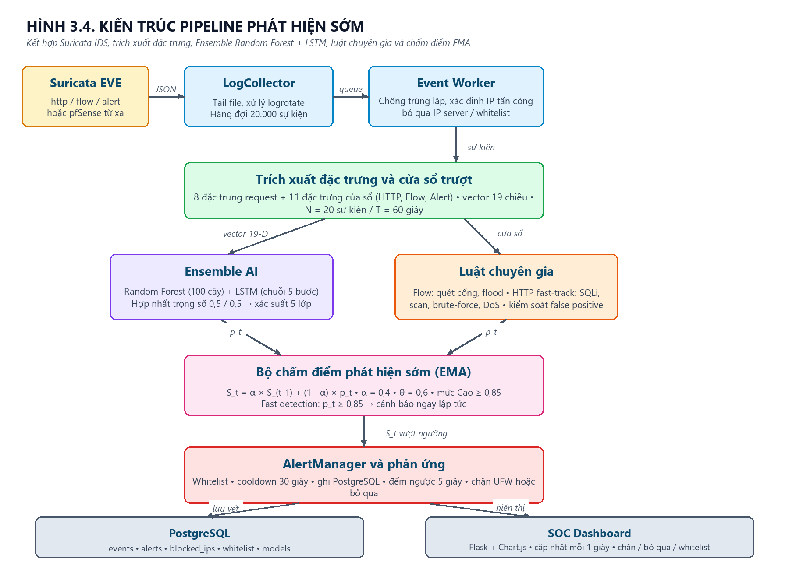
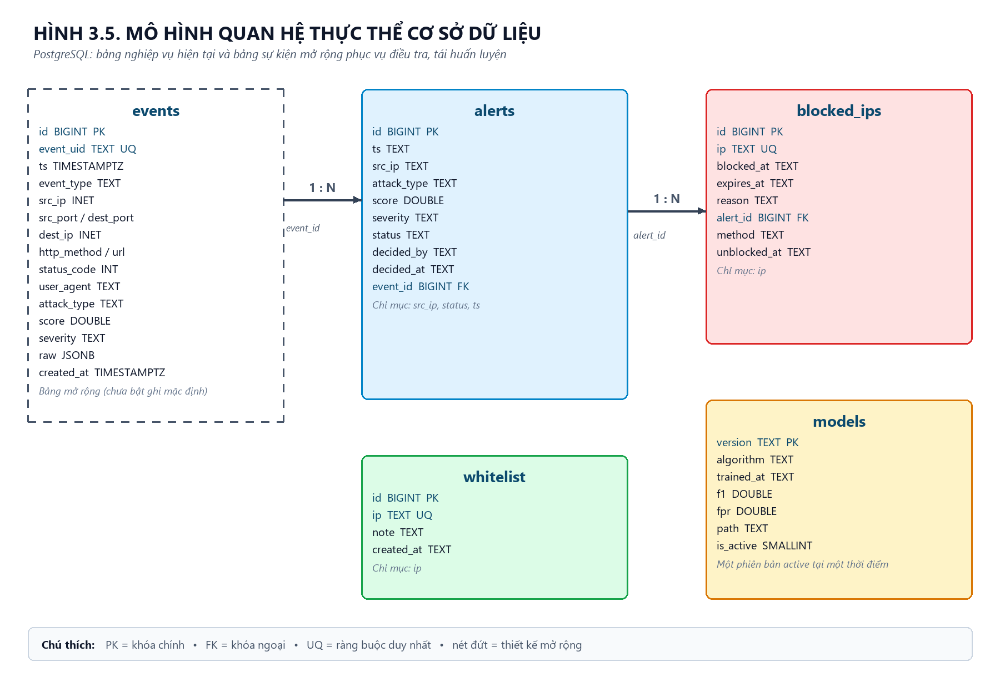
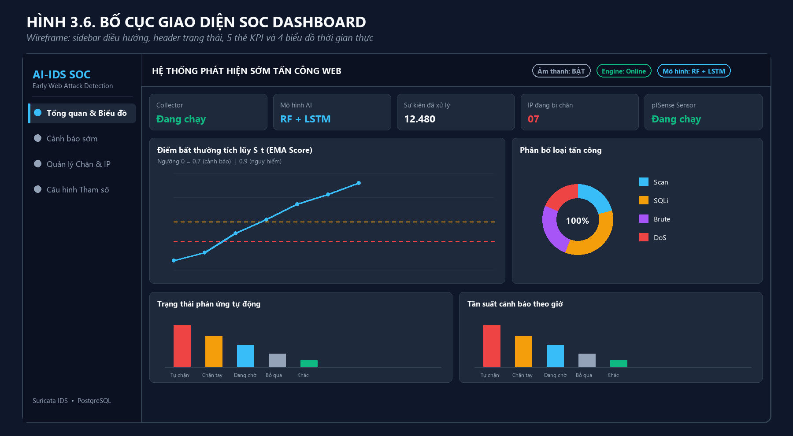

# 3.4. THIẾT KẾ MÔ HÌNH AI VÀ CƠ CHẾ PHÁT HIỆN SỚM

Mô hình phát hiện sớm tấn công web được thiết kế theo hướng **kết hợp (hybrid)** giữa học máy và luật chuyên gia. Học máy đảm nhiệm việc nhận diện các mẫu hành vi phức tạp, có tính biến đổi và chưa từng xuất hiện; luật chuyên gia đảm bảo các dấu hiệu tấn công rõ ràng được phát hiện ngay lập tức, đồng thời kiểm soát các trường hợp báo nhầm. Cách tiếp cận này phù hợp với môi trường giám sát an ninh mạng thực tế, nơi vừa cần độ nhạy cao vừa phải hạn chế cảnh báo nhiễu.

## 3.4.1. Mục tiêu và nguyên tắc thiết kế

Hệ thống hướng tới các mục tiêu sau:

- **Phát hiện sớm trước khi tấn công hoàn tất.** Mỗi sự kiện không được đánh giá độc lập mà được tích lũy thành một điểm bất thường theo thời gian cho từng địa chỉ IP. Khi điểm này vượt ngưỡng, cảnh báo được tạo ra ngay cả khi cuộc tấn công mới chỉ ở giai đoạn dò quét hoặc thử nghiệm.
- **Kết hợp mô hình học máy và luật chuyên gia.** Mô hình Ensemble Random Forest + LSTM nhận diện bất thường dựa trên 19 đặc trưng; các luật fast-track xử lý tức thời những hành vi có bằng chứng rõ ràng như SQL Injection, quét cổng, brute-force hay DoS.
- **Theo dõi theo IP và cửa sổ thời gian.** Trạng thái được duy trì riêng cho từng IP nguồn, giới hạn bởi N sự kiện gần nhất và T giây gần nhất, nhờ đó phản ánh được động thái của từng kẻ tấn công.
- **Ưu tiên giảm báo nhầm.** Hệ thống loại trừ IP của máy chủ, dải mạng bảo vệ, IP cục bộ và whitelist; yêu cầu bằng chứng cụ thể trước khi kết luận tấn công; áp dụng thời gian cooldown và chống xử lý trùng lặp.
- **Hoạt động gần thời gian thực, không phụ thuộc GPU.** Toàn bộ pipeline chạy trên CPU, sử dụng mô hình nhẹ và có cơ chế dự phòng khi thiếu mô hình LSTM.
- **Có khả năng giải thích.** Mỗi cảnh báo lưu lại loại tấn công, điểm tích lũy, mức độ và thời điểm; nhật ký hệ thống ghi rõ luật nào đã kích hoạt, chỉ số nào vượt ngưỡng.

Bảng 3.4 tổng hợp các yêu cầu thiết kế và giải pháp tương ứng.

**Bảng 3.4. Yêu cầu thiết kế và giải pháp kỹ thuật**

| Yêu cầu | Giải pháp trong hệ thống |
|---|---|
| Phát hiện sớm, không chờ kết thúc cuộc tấn công | Điểm EMA tích lũy theo từng sự kiện, cảnh báo ngay khi vượt ngưỡng |
| Nhận diện nhiều loại tấn công web | Phân loại 5 lớp: normal, scan, sqli, bruteforce, dos |
| Thích nghi với hành vi chưa biết | Random Forest + LSTM học từ đặc trưng hành vi và chuỗi thời gian |
| Giảm báo nhầm | Luật cần bằng chứng, lọc IP server, whitelist, cooldown, chống replay |
| Độ trễ thấp | Đọc log theo cơ chế tail, hàng đợi bất đồng bộ, suy luận CPU |
| Hoạt động khi thiếu thành phần | Tự động chuyển sang RF-only hoặc luật heuristic dự phòng |
| Có thể kiểm toán | Lưu cảnh báo, IP bị chặn, whitelist và metadata mô hình trong PostgreSQL |

## 3.4.2. Kiến trúc tổng thể và luồng xử lý

Kiến trúc phát hiện được tổ chức thành một pipeline xử lý sự kiện liên tục, từ khâu thu thập log đến khâu cảnh báo và phản ứng. Hình 3.4 mô tả kiến trúc tổng thể.



Luồng xử lý gồm các bước chính:

1. **Thu thập log.** `LogCollector` theo dõi tệp `eve.json` của Suricata theo cơ chế tail, xử lý được log xoay vòng hoặc bị truncate. Khi dùng pfSense, `PfSenseLogCollector` đồng bộ log từ xa qua SSH/SFTP hoặc HTTP webhook rồi ghi vào tệp cục bộ. Sự kiện hợp lệ được đẩy vào hàng đợi có sức chứa 20.000 phần tử.
2. **Lọc và chuẩn hóa sự kiện.** Worker kiểm tra trùng lặp bằng dấu vân tay sự kiện, xác định đâu là IP tấn công thật, loại bỏ lưu lượng do phía server tự khởi tạo và bỏ qua các IP được bảo vệ.
3. **Trích xuất đặc trưng.** Với sự kiện HTTP, hệ thống tính 8 đặc trưng mức request và 11 đặc trưng mức cửa sổ, tạo thành vector 19 chiều. Cửa sổ trượt lưu tối đa 20 sự kiện trong 60 giây gần nhất cho mỗi IP.
4. **Suy luận bằng mô hình.** Vector đặc trưng được đưa qua Random Forest; chuỗi 5 vector gần nhất được đưa qua LSTM. Hai đầu ra được hợp nhất theo trọng số để tạo xác suất tấn công.
5. **Đối chiếu luật chuyên gia.** Các luật flow và HTTP fast-track kiểm tra những dấu hiệu rõ ràng. Nếu luật phát hiện tấn công, kết quả luật được ưu tiên áp dụng thay cho dự đoán của mô hình.
6. **Tính điểm phát hiện sớm.** Bộ chấm điểm EMA cập nhật điểm tích lũy của IP theo công thức làm mịn số mũ. Điểm vượt ngưỡng sẽ kích hoạt cảnh báo và phân loại mức độ.
7. **Quản lý cảnh báo và phản ứng.** `AlertManager` kiểm tra whitelist, kiểm tra IP đã bị chặn, áp dụng cooldown, ghi cảnh báo vào PostgreSQL và khởi động đồng hồ đếm ngược nếu bật tự động chặn. Quản trị viên có thể chặn thủ công hoặc bỏ qua trên giao diện.
8. **Hiển thị và giám sát.** Dashboard Flask truy vấn API mỗi giây để cập nhật trạng thái, biểu đồ, bảng cảnh báo và danh sách IP bị chặn.

Ba loại sự kiện Suricata được xử lý theo ba nhánh khác nhau, tóm tắt trong Bảng 3.5.

**Bảng 3.5. Phân nhánh xử lý theo loại sự kiện**

| Loại sự kiện | Dữ liệu sử dụng | Cách xử lý | Kết quả |
|---|---|---|---|
| `http` | URL, method, status, User-Agent, body | Trích xuất 19 đặc trưng, suy luận Ensemble, đối chiếu fast-track, tính EMA | Cảnh báo sqli, scan, bruteforce, dos hoặc bỏ qua |
| `flow` | Cổng đích, thời lượng, số gói, số byte | Cập nhật cửa sổ flow, đánh giá luật quét cổng và flood, tính EMA | Cảnh báo scan hoặc dos |
| `alert` | Chữ ký, mức độ Severity | Lọc chữ ký nhiễu, ánh xạ chữ ký sang loại tấn công, tính EMA | Cảnh báo theo chữ ký Suricata |

Thiết kế sử dụng hàng đợi và luồng worker riêng để việc đọc log không bị chặn bởi quá trình suy luận hoặc truy vấn cơ sở dữ liệu. Cơ chế này giúp hệ thống chịu được các đợt bùng nổ sự kiện ngắn, đồng thời vẫn giữ được thứ tự xử lý tương đối ổn định.

## 3.4.3. Thiết kế đặc trưng đầu vào

Đặc trưng là yếu tố quyết định chất lượng của mô hình. Hệ thống sử dụng 19 đặc trưng, chia thành bốn nhóm: đặc trưng mức request, đặc trưng cửa sổ HTTP, đặc trưng cửa sổ flow và đặc trưng cảnh báo Suricata. Việc lựa chọn 19 đặc trưng thay vì toàn bộ nội dung gói tin giúp giảm chi phí tính toán, hạn chế nhiễu và bảo vệ dữ liệu nhạy cảm.

**Bảng 3.6. Danh sách 19 đặc trưng đầu vào của mô hình**

| Nhóm | Đặc trưng | Ý nghĩa và cách tính |
|---|---|---|
| Request | `url_length` | Độ dài URL sau khi giải mã phần trăm |
| Request | `special_char_count` | Số ký tự đặc biệt thuộc tập `' " ; < > ( ) = -` |
| Request | `sql_keyword_count` | Số lần xuất hiện của 12 từ khóa SQL như select, union, insert, update, delete, drop, sleep, benchmark, `--`, `xp_cmdshell`, `information_schema` |
| Request | `param_entropy` | Entropy Shannon của query string và body: `H = -Σ p_i log2(p_i)` |
| Request | `method_is_post` | Bằng 1 nếu phương thức là POST, ngược lại bằng 0 |
| Request | `status` | Mã trạng thái HTTP của phản hồi |
| Request | `is_login_path` | Bằng 1 nếu đường dẫn khớp danh sách trang đăng nhập |
| Request | `user_agent_flag` | Bằng 1 nếu User-Agent chứa tên công cụ tấn công như sqlmap, nikto, hydra, nmap, gobuster |
| Cửa sổ HTTP | `req_rate` | Số request chia cho khoảng thời gian quan sát, tối thiểu 1 giây |
| Cửa sổ HTTP | `unique_urls` | Số URL khác nhau trong cửa sổ |
| Cửa sổ HTTP | `ratio_4xx` | Tỷ lệ phản hồi 4xx trên tổng số request HTTP |
| Cửa sổ HTTP | `login_fail_count` | Số lần đăng nhập thất bại trên các đường dẫn đăng nhập |
| Cửa sổ HTTP | `inter_request_time` | Khoảng thời gian trung bình giữa hai request liên tiếp |
| Cửa sổ Flow | `unique_dst_ports` | Số cổng đích khác nhau mà IP đã kết nối tới |
| Cửa sổ Flow | `short_flow_count` | Số luồng ngắn, có thời lượng dưới 1 giây hoặc dưới 500 byte |
| Cửa sổ Flow | `pkts_per_sec` | Tổng số gói chia cho khoảng thời gian quan sát |
| Cửa sổ Flow | `bytes_per_sec` | Tổng số byte chia cho khoảng thời gian quan sát |
| Cửa sổ Flow | `concurrent_flows` | Số luồng được ghi nhận đồng thời trong cửa sổ |
| Cảnh báo | `suricata_alert_count` | Số cảnh báo Suricata liên quan đến IP trong cửa sổ |

Các đặc trưng mức request phản ánh dấu hiệu trực tiếp trong nội dung yêu cầu. Ví dụ, URL dài bất thường, nhiều ký tự đặc biệt, entropy cao và xuất hiện từ khóa SQL là tổ hợp điển hình của SQL Injection. Các đặc trưng cửa sổ phản ánh hành vi theo thời gian: tốc độ request, mức độ phân tán URL, tỷ lệ lỗi 4xx, số cổng bị quét và tốc độ gói. Nhóm này giúp phân biệt một request đơn lẻ bất thường với một chiến dịch tấn công kéo dài.

Trước khi đưa vào mô hình, vector đặc trưng được chuẩn hóa bằng `StandardScaler` được fit trên tập huấn luyện. Với Random Forest, vector 19 chiều được chuẩn hóa một lần. Với LSTM, mỗi vector trong chuỗi 5 bước được chuẩn hóa bằng cùng bộ scaler, sau đó giữ nguyên cấu trúc `(5, 19)`. Khi IP mới có ít hơn 5 sự kiện, hệ thống đệm bằng cách nhân bản vector đầu tiên để mô hình vẫn có đủ độ dài chuỗi.

## 3.4.4. Nhánh Random Forest

Random Forest là mô hình phân loại chính cho từng vector đặc trưng. Mô hình gồm 100 cây quyết định, độ sâu tối đa 14, số mẫu tối thiểu để tách nút là 4 và sử dụng `class_weight="balanced"` để giảm ảnh hưởng của mất cân bằng lớp. Mỗi cây được huấn luyện trên một tập con dữ liệu và tập con đặc trưng ngẫu nhiên; kết quả cuối cùng là trung bình xác suất của 100 cây.

Với một vector đặc trưng `x`, nhánh Random Forest trả về phân phối xác suất:

`P_RF(c | x)`, với `c ∈ {normal, scan, sqli, bruteforce, dos}`

Random Forest phù hợp với bài toán này vì dữ liệu đặc trưng có quan hệ phi tuyến, nhiều đặc trưng có thang đo khác nhau và chứa ngoại lai. Mô hình cũng tương đối ổn định khi dữ liệu huấn luyện nhỏ, thời gian suy luận thấp và có thể giải thích thông qua mức độ quan trọng của đặc trưng. Trong hệ thống, Random Forest đóng vai trò **baseline theo từng request và cửa sổ**, trong khi LSTM bổ sung thông tin về diễn biến thời gian.

**Bảng 3.7. Siêu tham số của Random Forest**

| Tham số | Giá trị | Vai trò |
|---|---|---|
| `n_estimators` | 100 | Số cây quyết định |
| `max_depth` | 14 | Giới hạn độ sâu, chống quá khớp |
| `min_samples_split` | 4 | Số mẫu tối thiểu để tách một nút |
| `class_weight` | `balanced` | Cân bằng trọng số giữa các lớp |
| `random_state` | 42 | Tái lập kết quả huấn luyện |
| `n_jobs` | -1 | Sử dụng toàn bộ lõi CPU |

## 3.4.5. Nhánh LSTM

LSTM (Long Short-Term Memory) xử lý chuỗi 5 vector đặc trưng liên tiếp của cùng một IP, tương ứng với 5 bước thời gian gần nhất. Đầu vào có kích thước `5 × 19`. Mạng học cách ghi nhớ các dấu hiệu xuất hiện trước đó và kết hợp với sự kiện hiện tại để nhận diện chuỗi hành vi, ví dụ:

- Chuỗi dò tham số SQL tăng dần từ `id=1` đến `id=1' OR 1=1--` rồi `UNION SELECT`.
- Chuỗi nhiều lần đăng nhập thất bại liên tiếp trên cùng một trang.
- Chuỗi quét nhiều URL và nhiều cổng trong thời gian ngắn, sau đó chuyển sang flood.

Kiến trúc mạng khi huấn luyện bằng PyTorch gồm: lớp LSTM một chiều với 64 đơn vị ẩn, lấy trạng thái ẩn ở bước cuối; dropout 0,2; lớp fully-connected 32 đơn vị với hàm kích hoạt ReLU; lớp đầu ra 5 đơn vị và hàm softmax. Mô hình được huấn luyện bằng Adam với learning rate 0,002, batch size 32, tối đa 12 epoch. Trong môi trường không có PyTorch, hệ thống dùng `NumpyLSTMClassifier` với 32 đơn vị ẩn, learning rate 0,008, 8 epoch và batch size 32. Cách triển khai này giữ cho hệ thống chạy được trên máy cấu hình thấp mà không cần cài đặt framework học sâu nặng.

**Bảng 3.8. Cấu hình nhánh LSTM**

| Thành phần | PyTorch LSTM | NumPy LSTM dự phòng |
|---|---|---|
| Độ dài chuỗi | 5 | 5 |
| Số đặc trưng mỗi bước | 19 | 19 |
| Số đơn vị ẩn | 64 | 32 |
| Dropout | 0,2 | Không bắt buộc |
| Hàm kích hoạt | ReLU | Tanh/ReLU tùy cấu hình |
| Hàm mất mát | CrossEntropy | CrossEntropy |
| Optimizer | Adam, lr = 0,002 | Adam, lr = 0,008 |
| Số epoch | 12 | 8 |
| Batch size | 32 | 32 |
| Đầu ra | 5 xác suất lớp | 5 xác suất lớp |

Bên cạnh PyTorch và NumPy, bộ nạp mô hình còn hỗ trợ định dạng Keras `.keras` nếu môi trường đã cài TensorFlow. Thứ tự ưu tiên khi nạp là NumPy, PyTorch, Keras; nếu không có LSTM, hệ thống tự động chuyển sang chế độ chỉ dùng Random Forest.

## 3.4.6. Hợp nhất Ensemble

Hai nhánh mô hình được hợp nhất theo trung bình có trọng số:

`P_Ensemble(c | x) = w_RF × P_RF(c | x) + w_LSTM × P_LSTM(c | x)`

Trong cấu hình mặc định, `w_RF = 0,5` và `w_LSTM = 0,5`. Nếu LSTM không được nạp, trọng số được chuẩn hóa lại thành `w_RF = 1,0` và `w_LSTM = 0,0`. Xác suất tấn công tại bước `t` được tính từ xác suất lớp bình thường:

`p_t = 1 - P_Ensemble(normal | x_t)`

Lớp dự đoán là lớp có xác suất lớn nhất. Giá trị `p_t` được giới hạn trong đoạn `[0, 1]` và làm tròn 4 chữ số thập phân. Cần lưu ý rằng đầu ra của mô hình được sử dụng như **mức tín nhiệm tương đối** phục vụ tích lũy điểm, không phải xác suất thống kê tuyệt đối đã được hiệu chỉnh. Vì vậy, ngưỡng cảnh báo được lựa chọn và điều chỉnh theo dữ liệu vận hành thực tế.

**Bảng 3.9. Các chế độ hoạt động của bộ phân loại**

| Trạng thái mô hình | Trọng số RF | Trọng số LSTM | Hành vi |
|---|---|---|---|
| Nạp được cả RF và LSTM | 0,5 | 0,5 | Ensemble đầy đủ |
| Chỉ nạp được RF | 1,0 | 0,0 | Dự đoán bằng Random Forest |
| Không nạp được mô hình | 0,0 | 0,0 | Dùng luật heuristic dự phòng |
| LSTM lỗi khi suy luận | 0,5 | 0,5 | LSTM dùng lại phân phối xác suất của RF, kết quả tương đương RF |

Cơ chế dự phòng nhiều tầng giúp hệ thống không bị gián đoạn khi thiếu tệp mô hình, thiếu thư viện học sâu hoặc xảy ra lỗi trong quá trình suy luận. Đây là yêu cầu quan trọng đối với một thành phần an ninh mạng, bởi việc mất mô hình AI không được phép làm mất hoàn toàn khả năng giám sát.

## 3.4.7. Cơ chế tính điểm phát hiện sớm

Điểm bất thường tích lũy được tính theo công thức làm mịn số mũ (Exponential Moving Average - EMA):

`S_t = α × S_(t-1) + (1 - α) × p_t`

Trong đó:

- `S_t` là điểm bất thường tích lũy của IP tại bước `t`.
- `S_(t-1)` là điểm của bước trước đó.
- `p_t` là xác suất tấn công do mô hình dự đoán tại bước `t`.
- `α` là hệ số suy giảm, mặc định bằng 0,4.

Công thức này cho phép điểm số vừa phản ánh lịch sử, vừa phản ứng với sự kiện mới. Khi `α` nhỏ, hệ thống phản ứng nhanh hơn với sự kiện mới nhưng dễ bị ảnh hưởng bởi nhiễu. Khi `α` lớn, điểm số ổn định hơn nhưng tăng chậm hơn. Giá trị 0,4 được chọn để cân bằng giữa độ nhạy và độ ổn định.

Hệ thống có thêm chế độ **fast detection**. Nếu `p_t ≥ 0,85`, điểm được cập nhật theo:

`S_t = max(p_t, α × S_(t-1) + (1 - α) × p_t)`

Nhờ đó, một hành vi tấn công rõ ràng có thể kích hoạt cảnh báo ngay lập tức thay vì phải chờ điểm tích lũy tăng dần qua nhiều bước. Đây là cơ chế quan trọng để đáp ứng mục tiêu phát hiện sớm.

Ngưỡng cảnh báo mặc định là `θ = 0,6`; ngưỡng mức độ cao là `0,85`. Quy tắc phân loại mức độ:

- `S_t ≥ 0,85`: mức **Cao**.
- `0,6 ≤ S_t < 0,85`: mức **Trung bình**.
- `S_t < 0,6`: chưa cảnh báo.

Bảng 3.10 minh họa quá trình tích lũy điểm qua một chuỗi sáu request SQL Injection. Đây là ví dụ mô phỏng nhằm làm rõ cơ chế, không phải kết quả đo trên một tập dữ liệu cụ thể.

**Bảng 3.10. Ví dụ mô phỏng tích lũy điểm EMA với α = 0,4**

| Bước | Mô tả sự kiện | `p_t` | `S_t` không fast | `S_t` có fast | Trạng thái |
|---|---|---|---|---|---|
| 1 | Request hợp lệ | 0,20 | 0,1200 | 0,1200 | Chưa cảnh báo |
| 2 | Thêm dấu nháy đơn | 0,40 | 0,2880 | 0,2880 | Chưa cảnh báo |
| 3 | Thử `OR 1=1` | 0,70 | 0,5352 | 0,5352 | Chưa cảnh báo |
| 4 | Thử `UNION SELECT` | 0,90 | 0,7541 | 0,9000 | **Cảnh báo** |
| 5 | Đọc dữ liệu qua UNION | 0,95 | 0,8716 | 0,9500 | **Cảnh báo mức Cao** |
| 6 | Thử `sleep(5)` | 0,95 | 0,9187 | 0,9500 | **Cảnh báo mức Cao** |

Ở bước 4, nếu không bật fast detection, điểm 0,7541 vẫn vượt ngưỡng 0,6 và tạo cảnh báo mức Trung bình. Khi bật fast detection, điểm nhảy lên 0,9 và cảnh báo được phân loại mức Cao ngay tại bước 4. Trong cả hai trường hợp, hệ thống đều cảnh báo trước khi chuỗi tấn công kết thúc, thể hiện đúng mục tiêu phát hiện sớm.

Bộ chấm điểm lưu trạng thái riêng cho từng IP và có cơ chế reset:

- Khi quản trị viên bấm **Bỏ qua**, điểm của IP được đặt lại về 0 và cooldown bị xóa để cuộc tấn công mới có thể được cảnh báo ngay.
- Khi IP không còn sự kiện trong khoảng thời gian bằng cửa sổ trượt, trạng thái cửa sổ và điểm số được xóa trong tiến trình bảo trì định kỳ.
- Cảnh báo trùng cho cùng cặp `(IP, loại tấn công)` bị chặn trong 30 giây để tránh báo lặp vô hạn.

## 3.4.8. Luật chuyên gia và kiểm soát báo nhầm

Mô hình học máy có thể bỏ sót những hành vi có dấu hiệu rất rõ nhưng chưa đủ mẫu huấn luyện. Vì vậy, hệ thống bổ sung hai nhóm luật: luật flow và luật HTTP fast-track. Các luật này chỉ kích hoạt khi có bằng chứng cụ thể, tránh biến mọi bất thường nhỏ thành cảnh báo.

### Luật flow

**Bảng 3.11. Ngưỡng luật phát hiện hành vi flow**

| Hành vi | Điều kiện kích hoạt | Ý nghĩa |
|---|---|---|
| Quét cổng | `unique_dst_ports ≥ 12` | IP kết nối tới nhiều cổng đích khác nhau |
| Quét cổng chậm | `short_flow_count ≥ 15` và `unique_dst_ports ≥ 4` | Nhiều luồng ngắn trải trên nhiều cổng |
| DoS flood | `peak_flow_pps ≥ 400` | Một luồng có tốc độ gói rất cao |
| DoS bùng nổ | `short_flow_count ≥ 18`, `window_span_seconds ≤ 3`, `window_total_pkts ≥ 800` | Nhiều luồng ngắn dồn dập với khối lượng gói lớn |

Các ngưỡng này được chọn đủ chặt để không báo nhầm lưu lượng duyệt web, SSH, DNS, cập nhật hệ thống hoặc dashboard nội bộ. Khi một luật flow kích hoạt, xác suất tấn công được gán tương ứng 0,95 cho quét cổng và 0,96 cho DoS, sau đó đưa vào bộ chấm điểm EMA.

### Luật HTTP fast-track

**Bảng 3.12. Luật HTTP fast-track**

| Loại tấn công | Bằng chứng kích hoạt | Xác suất gán |
|---|---|---|
| SQL Injection | User-Agent chứa `sqlmap` hoặc `havij` | 0,98 |
| SQL Injection | `sql_keyword_count ≥ 2` và `special_char_count ≥ 3` | 0,98 |
| SQL Injection | `sql_keyword_count ≥ 1`, `special_char_count ≥ 3` và URL chứa dấu hiệu payload SQL | 0,98 |
| Quét đường dẫn | User-Agent chứa nmap, gobuster, dirbuster, wpscan, masscan, nikto, skipfish | 0,95 |
| Quét đường dẫn | `ratio_4xx ≥ 0,6` và `unique_urls ≥ 10` | 0,95 |
| Brute-force | User-Agent chứa hydra, medusa, patator, ncrack | 0,95 |
| Brute-force | `login_fail_count ≥ 5` | 0,95 |
| DoS tầng ứng dụng | `req_rate ≥ 25` và `window_http_count ≥ 5` | 0,96 |
| DoS tầng ứng dụng | `peak_flow_pps ≥ 400` | 0,96 |

Điểm quan trọng trong thiết kế là **không kết luận SQL Injection chỉ dựa trên từ khóa**. Các URL hợp lệ như `/delete.php?id=3` hoặc `/update_profile.php` có thể chứa từ khóa `delete`, `update` nhưng không phải tấn công. Vì vậy, luật yêu cầu thêm dấu hiệu payload như dấu nháy đơn, `--`, `UNION`, `SLEEP(`, `BENCHMARK(`, `information_schema` hoặc `xp_cmdshell`. Tương tự, User-Agent `curl` hoặc `python-requests` chỉ được cộng điểm nhẹ 0,75 thay vì tạo cảnh báo ngay, bởi đây cũng là công cụ hợp lệ cho health-check và script nội bộ.

### Các biện pháp kiểm soát báo nhầm

**Bảng 3.13. Các lớp kiểm soát false positive**

| Cơ chế | Cách hoạt động | Tác dụng |
|---|---|---|
| Nhận diện phía server | Dùng `server_ips`, `protected_networks`, cổng dịch vụ và IP cục bộ để xác định client/server | Không gán IP máy chủ là kẻ tấn công |
| Bỏ qua lưu lượng server tự tạo | Nếu `src_ip` là phía server và `dest_ip` là client, bỏ qua sự kiện | Tránh cảnh báo từ SSH, DNS, apt, dashboard |
| Whitelist | Kiểm tra bảng `whitelist` trước khi tạo cảnh báo và trước khi chặn | Bảo vệ gateway, IP quản trị, IP tin cậy |
| Lọc chữ ký Suricata | Bỏ qua chữ ký có Severity ≥ 3 | Loại bỏ cảnh báo mức thấp/nhiễu |
| Chống trùng lặp | Lưu 5.000 dấu vân tay sự kiện gần nhất | Tránh xử lý lại log khi tệp bị đọc lặp |
| Cooldown | 30 giây cho cùng cặp IP + loại tấn công | Tránh bão cảnh báo khi tấn công đã dừng |
| Xóa trạng thái IP idle | Reset cửa sổ và điểm khi IP ngừng gửi sự kiện | Không tiếp tục cảnh báo sau khi cuộc tấn công kết thúc |
| Bắt đầu từ cuối log | `start_at_end: true` | Không phát lại log cũ khi khởi động |
| Luật cần bằng chứng | Yêu cầu tổ hợp nhiều chỉ số thay vì một từ khóa | Giảm cảnh báo giả trên URL hợp lệ |

Các biện pháp trên được thiết kế theo nguyên tắc **phòng thủ nhiều lớp**: một sự kiện chỉ tạo cảnh báo khi vừa vượt qua bộ lọc IP, vừa có tín hiệu từ mô hình hoặc luật, vừa vượt ngưỡng tích lũy và chưa nằm trong thời gian cooldown.

## 3.4.9. Quy trình huấn luyện và đánh giá mô hình

Dữ liệu huấn luyện mẫu gồm 2.500 mẫu, phân bố đều cho 5 lớp, mỗi lớp 500 mẫu. Mỗi mẫu chứa 19 đặc trưng và nhãn lớp. Tập dữ liệu được chia thành 80% huấn luyện và 20% kiểm thử theo phương pháp phân tầng (`stratify`) với `random_state = 42`, đảm bảo cả 5 lớp đều xuất hiện trong cả hai tập.

Quy trình huấn luyện gồm các bước:

1. Đọc tệp CSV và kiểm tra đầy đủ 19 cột đặc trưng cùng cột nhãn.
2. Phân chia tập huấn luyện và kiểm thử theo tỷ lệ 80/20, giữ phân bố lớp.
3. Fit `StandardScaler` trên tập huấn luyện và áp dụng cho tập kiểm thử.
4. Huấn luyện Random Forest với cấu hình trong Bảng 3.7.
5. Tạo chuỗi trượt 5 bước cho LSTM từ dữ liệu đã chuẩn hóa.
6. Huấn luyện LSTM bằng PyTorch nếu có, ngược lại dùng NumPy LSTM.
7. Tính xác suất Ensemble bằng trung bình có trọng số.
8. Đánh giá Precision, Recall, F1-Score và FPR cho từng lớp, Macro-F1 và Weighted-F1.
9. Lưu mô hình, scaler, danh sách đặc trưng và metadata vào thư mục `models/`.
10. Ghi phiên bản mô hình vào bảng `models` trong PostgreSQL.

Các chỉ số đánh giá được tính như sau:

- `Precision = TP / (TP + FP)`
- `Recall = TP / (TP + FN)`
- `F1 = 2 × Precision × Recall / (Precision + Recall)`
- `FPR = FP / (FP + TN)`
- `Macro-F1` là trung bình F1 của các lớp, không tính đến số lượng mẫu.
- `Weighted-F1` là trung bình F1 có trọng số theo số lượng mẫu của từng lớp.

FPR của lớp `normal` đặc biệt quan trọng vì nó phản ánh tỷ lệ lưu lượng bình thường bị báo nhầm là tấn công. Giá trị này được lưu vào cột `fpr` của bảng `models` để phục vụ so sánh giữa các phiên bản.

**Bảng 3.14. Phân bố dữ liệu huấn luyện mẫu**

| Lớp | Số mẫu | Đặc điểm chính |
|---|---|---|
| `normal` | 500 | Request hợp lệ, ít ký tự đặc biệt, tần suất thấp |
| `scan` | 500 | Nhiều URL, tỷ lệ 4xx cao, nhiều cổng đích |
| `sqli` | 500 | URL dài, nhiều ký tự đặc biệt, có từ khóa SQL |
| `bruteforce` | 500 | POST tới trang đăng nhập, nhiều lần thất bại |
| `dos` | 500 | Tần suất request và tốc độ gói rất cao |

Kết quả thực nghiệm chi tiết được trình bày ở chương đánh giá. Trong phạm vi thiết kế, quy trình trên bảo đảm mô hình có thể tái huấn luyện, so sánh phiên bản và thay thế mà không thay đổi pipeline phát hiện.

## 3.4.10. Tham số cấu hình và khả năng điều chỉnh

Các tham số quan trọng được đưa vào `config.yaml` để có thể điều chỉnh mà không sửa mã nguồn. Bảng 3.15 tóm tắt các tham số chính.

**Bảng 3.15. Tham số cấu hình chính của cơ chế phát hiện**

| Nhóm | Khóa cấu hình | Giá trị mặc định | Ảnh hưởng |
|---|---|---|---|
| Chấm điểm | `scoring.alpha` | 0,4 | Tăng: ổn định hơn, phản ứng chậm hơn; giảm: nhạy hơn |
| Chấm điểm | `scoring.theta` | 0,6 | Tăng: ít cảnh báo hơn; giảm: nhạy hơn |
| Chấm điểm | `scoring.high_threshold` | 0,85 | Ngưỡng phân loại mức Cao |
| Chấm điểm | `scoring.fast_detection` | `true` | Bật cảnh báo tức thời khi `p_t ≥ 0,85` |
| Cửa sổ | `sliding_window.window_size_n` | 20 | Số sự kiện tối đa mỗi IP |
| Cửa sổ | `sliding_window.window_time_t` | 60 | Thời gian quan sát tính bằng giây |
| Cảnh báo | `alert.countdown_seconds` | 5 | Thời gian chờ trước khi tự động chặn |
| Cảnh báo | `alert.auto_block_enabled` | `false` | Chế độ chỉ cảnh báo, không tự ngắt kết nối |
| Cảnh báo | `alert.cooldown_seconds` | 30 | Khoảng lặng giữa hai cảnh báo cùng IP + loại |
| Chặn | `blocking.default_duration_minutes` | 60 | Thời hạn chặn mặc định |
| Thu thập | `log.poll_interval` | 0,2 | Chu kỳ đọc log |
| Thu thập | `log.start_at_end` | `true` | Bỏ qua log cũ khi khởi động |
| pfSense | `pfsense.sync_interval` | 1 | Chu kỳ đồng bộ log từ pfSense |
| Giao diện | `dashboard.port` | 5000 | Cổng Flask Dashboard |

Việc tách tham số khỏi mã nguồn cho phép quản trị viên điều chỉnh độ nhạy theo môi trường. Trong môi trường thử nghiệm, có thể giảm `theta` và bật `fast_detection` để quan sát nhiều cảnh báo hơn. Trong môi trường thật, nên tăng `theta`, tăng ngưỡng luật và kiểm tra whitelist kỹ trước khi bật tự động chặn.

---

# 3.5. THIẾT KẾ CƠ SỞ DỮ LIỆU VÀ GIAO DIỆN

Cơ sở dữ liệu và giao diện là hai thành phần bảo đảm hệ thống không chỉ phát hiện được tấn công mà còn lưu vết, hỗ trợ ra quyết định và vận hành thuận tiện. Phần này trình bày thiết kế vật lý trên PostgreSQL, quan hệ giữa các bảng, vòng đời dữ liệu và thiết kế giao diện SOC Dashboard.

## 3.5.1. Mục tiêu thiết kế và lựa chọn PostgreSQL

Hệ thống chọn PostgreSQL làm cơ sở dữ liệu duy nhất cho các thông tin nghiệp vụ. Các yêu cầu chính gồm:

- Lưu trữ cảnh báo, IP bị chặn, whitelist và metadata mô hình.
- Hỗ trợ truy vấn theo thời gian, theo IP, theo trạng thái và theo loại tấn công.
- Bảo đảm tính nguyên tử khi tạo cảnh báo, chặn IP và cập nhật trạng thái.
- Cho phép nhiều luồng đọc/ghi đồng thời: collector, worker, dashboard và tiến trình bảo trì.
- Dễ sao lưu, phục hồi và phân quyền.
- Có thể mở rộng lưu trữ sự kiện thô dưới dạng JSONB phục vụ điều tra và tái huấn luyện.

PostgreSQL đáp ứng các yêu cầu này nhờ tính ACID, hỗ trợ chỉ mục phong phú, kiểu dữ liệu JSONB, khả năng xử lý truy vấn thời gian và hệ sinh thái công cụ ổn định. Ứng dụng kết nối qua `psycopg2`, sử dụng câu lệnh tham số hóa để chống SQL Injection và tự động tạo schema khi khởi động.

Thông tin kết nối được đặt trong mục `database` của `config.yaml`:

- `host`, `port`, `dbname`, `user`, `password`, `connect_timeout`.
- Có thể thay bằng biến môi trường `DATABASE_URL`.
- Mật khẩu nên đặt qua `POSTGRES_PASSWORD`, không lưu trực tiếp trong tệp cấu hình khi triển khai thật.

Mỗi thao tác cơ sở dữ liệu được thực hiện trong một context manager: mở kết nối, chạy lệnh, commit nếu thành công, rollback nếu có lỗi và đóng kết nối. Cách làm này đơn giản, dễ kiểm soát giao dịch và phù hợp với tải của một hệ thống giám sát quy mô vừa.

**Bảng 3.16. Yêu cầu dữ liệu và giải pháp**

| Yêu cầu | Giải pháp |
|---|---|
| Lưu cảnh báo lâu dài | Bảng `alerts`, có chỉ mục theo IP và trạng thái |
| Truy vấn nhanh IP đang bị chặn | Bảng `blocked_ips`, ràng buộc UNIQUE trên `ip`, chỉ mục `idx_blocked_ip` |
| Bảo vệ IP tin cậy | Bảng `whitelist`, ràng buộc UNIQUE trên `ip` |
| Quản lý phiên bản mô hình | Bảng `models`, khóa chính `version`, cột `is_active` |
| Lưu sự kiện thô để điều tra | Thiết kế bảng `events` với cột `raw JSONB`, chỉ mục thời gian và IP |
| Bảo đảm toàn vẹn | Khóa ngoại `blocked_ips.alert_id` tham chiếu `alerts.id` |
| Bảo mật truy vấn | Câu lệnh tham số hóa, phân quyền tối thiểu |

## 3.5.2. Mô hình dữ liệu logic và quan hệ

Mô hình dữ liệu gồm năm thực thể: sự kiện, cảnh báo, IP bị chặn, whitelist và phiên bản mô hình. Hình 3.5 mô tả quan hệ giữa các thực thể.



Quan hệ chính:

- Một **sự kiện** có thể tạo ra không hoặc nhiều **cảnh báo**. Trong thiết kế mở rộng, bảng `alerts` có thêm `event_id` tham chiếu `events.id` để truy vết từ cảnh báo về sự kiện gốc.
- Một **cảnh báo** có thể dẫn tới một hoặc nhiều bản ghi **IP bị chặn**. Trong phiên bản hiện tại, `blocked_ips.alert_id` là khóa ngoại tham chiếu `alerts.id`.
- **Whitelist** độc lập với cảnh báo và IP bị chặn; đây là danh sách miễn trừ được kiểm tra trước khi tạo cảnh báo và trước khi chặn.
- **Models** độc lập, lưu metadata của từng phiên bản mô hình; tại một thời điểm chỉ một phiên bản có `is_active = 1`.

**Bảng 3.17. Quan hệ giữa các bảng**

| Bảng nguồn | Bảng đích | Khóa liên kết | Kiểu quan hệ | Ý nghĩa |
|---|---|---|---|---|
| `events` | `alerts` | `alerts.event_id → events.id` | 1 - N | Một sự kiện có thể sinh nhiều cảnh báo |
| `alerts` | `blocked_ips` | `blocked_ips.alert_id → alerts.id` | 1 - N | Một cảnh báo có thể dẫn tới chặn IP |
| `whitelist` | — | `ip` | Độc lập | Danh sách miễn trừ |
| `models` | — | `version` | Độc lập | Quản lý phiên bản mô hình |

## 3.5.3. Thiết kế các bảng dữ liệu

### Bảng sự kiện `events`

Bảng `events` lưu sự kiện đã chuẩn hóa và/hoặc sự kiện thô từ Suricata. Thiết kế này phục vụ ba mục đích: điều tra sự cố, tái huấn luyện mô hình và đối chiếu cảnh báo với dữ liệu gốc.

**Bảng 3.18. Cấu trúc bảng `events`**

| Cột | Kiểu dữ liệu | Ràng buộc | Mô tả |
|---|---|---|---|
| `id` | `BIGINT` | PK, identity | Khóa chính |
| `event_uid` | `TEXT` | UNIQUE | Mã định danh chống trùng lặp |
| `ts` | `TIMESTAMPTZ` | NOT NULL | Thời điểm sự kiện |
| `event_type` | `TEXT` | NOT NULL | `http`, `flow`, `alert`, `dns`, `tls`... |
| `src_ip` | `INET` | NOT NULL | IP nguồn |
| `src_port` | `INTEGER` | | Cổng nguồn |
| `dest_ip` | `INET` | | IP đích |
| `dest_port` | `INTEGER` | | Cổng đích |
| `http_method` | `TEXT` | | Phương thức HTTP |
| `url` | `TEXT` | | URL đã chuẩn hóa |
| `status_code` | `INTEGER` | | Mã trạng thái HTTP |
| `user_agent` | `TEXT` | | User-Agent |
| `attack_type` | `TEXT` | | Loại tấn công do hệ thống gán |
| `score` | `DOUBLE PRECISION` | | Điểm EMA tại thời điểm sự kiện |
| `severity` | `TEXT` | | Mức độ cảnh báo |
| `raw` | `JSONB` | | Toàn bộ sự kiện gốc |
| `created_at` | `TIMESTAMPTZ` | DEFAULT `now()` | Thời điểm ghi CSDL |

Các chỉ mục đề xuất cho bảng `events`:

- `idx_events_ts` trên `ts DESC` phục vụ truy vấn theo thời gian.
- `idx_events_src_ts` trên `(src_ip, ts DESC)` phục vụ điều tra theo IP.
- `idx_events_attack_ts` trên `(attack_type, ts DESC)` phục vụ thống kê.
- `idx_events_raw_gin` dùng GIN trên `raw` phục vụ tìm kiếm JSON.

Với hệ thống có lưu lượng lớn, bảng `events` nên được phân vùng theo tháng và áp dụng chính sách lưu trữ luân chuyển, ví dụ giữ 30-90 ngày dữ liệu thô. Dữ liệu tổng hợp và cảnh báo có thể giữ lâu hơn.

> **Ghi chú triển khai:** Phiên bản hiện tại xử lý sự kiện trong bộ nhớ và chỉ lưu cảnh báo, IP bị chặn, whitelist và metadata mô hình. Bảng `events` là thiết kế mở rộng dành cho nhu cầu điều tra và tái huấn luyện; khi bật ghi sự kiện, nên ghi theo lô hoặc qua hàng đợi để không làm tăng độ trễ của pipeline phát hiện.

### Bảng cảnh báo `alerts`

Bảng `alerts` là bảng trung tâm của hệ thống, lưu mọi cảnh báo do mô hình hoặc luật tạo ra.

**Bảng 3.19. Cấu trúc bảng `alerts`**

| Cột | Kiểu dữ liệu | Ràng buộc | Mô tả |
|---|---|---|---|
| `id` | `BIGINT` | PK, identity | Khóa chính |
| `ts` | `TEXT` | NOT NULL | Thời điểm tạo cảnh báo, định dạng ISO-8601 |
| `src_ip` | `TEXT` | NOT NULL | IP nguồn bị cảnh báo |
| `attack_type` | `TEXT` | NOT NULL | `scan`, `sqli`, `bruteforce`, `dos`, `anomaly` |
| `score` | `DOUBLE PRECISION` | NOT NULL | Điểm EMA `S_t` |
| `severity` | `TEXT` | NOT NULL | `Cao` hoặc `Trung bình` |
| `status` | `TEXT` | NOT NULL | Trạng thái xử lý |
| `decided_by` | `TEXT` | | `admin` hoặc `system` |
| `decided_at` | `TEXT` | | Thời điểm ra quyết định |
| `event_id` | `BIGINT` | FK → `events.id` | Liên kết sự kiện gốc (thiết kế mở rộng) |

Các trạng thái cảnh báo:

- `pending`: đang chờ quản trị viên quyết định, có đồng hồ đếm ngược nếu bật tự động chặn.
- `alerted`: chỉ cảnh báo, không tự động chặn (khi `auto_block_enabled = false`).
- `manual_blocked`: quản trị viên chặn thủ công.
- `auto_blocked`: hệ thống tự động chặn khi hết thời gian đếm ngược.
- `ignored`: quản trị viên bỏ qua cảnh báo.

Bảng `alerts` có hai chỉ mục hiện có: `idx_alerts_ip` trên `src_ip` và `idx_alerts_status` trên `status`. Để tối ưu biểu đồ thời gian và truy vấn `ORDER BY id DESC`, nên bổ sung chỉ mục trên `ts` hoặc `id`.

### Bảng IP bị chặn `blocked_ips`

Bảng `blocked_ips` lưu trạng thái chặn của từng IP, bao gồm thời hạn, lý do, phương thức thực thi và liên kết tới cảnh báo.

**Bảng 3.20. Cấu trúc bảng `blocked_ips`**

| Cột | Kiểu dữ liệu | Ràng buộc | Mô tả |
|---|---|---|---|
| `id` | `BIGINT` | PK, identity | Khóa chính |
| `ip` | `TEXT` | NOT NULL, UNIQUE | Địa chỉ IP bị chặn |
| `blocked_at` | `TEXT` | NOT NULL | Thời điểm bắt đầu chặn |
| `expires_at` | `TEXT` | | Thời điểm hết hạn |
| `reason` | `TEXT` | | Lý do chặn |
| `alert_id` | `BIGINT` | FK → `alerts.id` | Cảnh báo nguồn |
| `method` | `TEXT` | | `ufw`, `ufw_failed`, `simulated`, `error` |
| `unblocked_at` | `TEXT` | | Thời điểm gỡ chặn |

Ràng buộc `UNIQUE(ip)` cho phép dùng câu lệnh `INSERT ... ON CONFLICT(ip) DO UPDATE` để gia hạn hoặc cập nhật bản ghi chặn hiện có thay vì tạo bản ghi trùng. Một IP đang bị chặn khi thỏa mãn đồng thời:

`unblocked_at IS NULL` và `(expires_at IS NULL OR expires_at > thời điểm hiện tại)`

Phương thức `simulated` được dùng khi chạy trên môi trường không phải Linux, cho phép kiểm thử luồng nghiệp vụ mà không thay đổi tường lửa thật.

### Bảng whitelist

**Bảng 3.21. Cấu trúc bảng `whitelist`**

| Cột | Kiểu dữ liệu | Ràng buộc | Mô tả |
|---|---|---|---|
| `id` | `BIGINT` | PK, identity | Khóa chính |
| `ip` | `TEXT` | NOT NULL, UNIQUE | IP tin cậy |
| `note` | `TEXT` | | Ghi chú |
| `created_at` | `TEXT` | NOT NULL | Thời điểm thêm |

Whitelist được kiểm tra ở hai thời điểm: trước khi tạo cảnh báo trong `AlertManager` và trước khi chặn trong `IPBlocker`. Cơ chế kiểm tra hai lớp này ngăn việc một IP tin cậy bị chặn do một luồng xử lý khác gọi trực tiếp bộ chặn.

### Bảng metadata mô hình `models`

**Bảng 3.22. Cấu trúc bảng `models`**

| Cột | Kiểu dữ liệu | Ràng buộc | Mô tả |
|---|---|---|---|
| `version` | `TEXT` | PK | Mã phiên bản, ví dụ `ensemble_rf_lstm_20261020_153000` |
| `algorithm` | `TEXT` | NOT NULL | Tên thuật toán |
| `trained_at` | `TEXT` | NOT NULL | Thời điểm huấn luyện |
| `f1` | `DOUBLE PRECISION` | NOT NULL | Macro-F1 |
| `fpr` | `DOUBLE PRECISION` | NOT NULL | FPR của lớp normal |
| `path` | `TEXT` | NOT NULL | Đường dẫn tệp mô hình |
| `is_active` | `SMALLINT` | NOT NULL, DEFAULT 0 | Phiên bản đang dùng |

Khi lưu một phiên bản mới với `is_active = 1`, hệ thống cập nhật tất cả bản ghi cũ về `is_active = 0` trong cùng giao dịch. Nhờ đó, tại một thời điểm chỉ có một phiên bản đang hoạt động, thuận tiện cho việc rollback và so sánh chất lượng mô hình.

## 3.5.4. Câu lệnh tạo schema

Schema được tạo tự động khi ứng dụng khởi động. Đoạn mã dưới đây mô tả các bảng và chỉ mục chính, bao gồm cả phần mở rộng `events`.

```sql
CREATE TABLE IF NOT EXISTS alerts (
    id BIGINT GENERATED BY DEFAULT AS IDENTITY PRIMARY KEY,
    ts TEXT NOT NULL,
    src_ip TEXT NOT NULL,
    attack_type TEXT NOT NULL,
    score DOUBLE PRECISION NOT NULL,
    severity TEXT NOT NULL,
    status TEXT NOT NULL,
    decided_by TEXT,
    decided_at TEXT
);

CREATE TABLE IF NOT EXISTS blocked_ips (
    id BIGINT GENERATED BY DEFAULT AS IDENTITY PRIMARY KEY,
    ip TEXT NOT NULL UNIQUE,
    blocked_at TEXT NOT NULL,
    expires_at TEXT,
    reason TEXT,
    alert_id BIGINT REFERENCES alerts(id),
    method TEXT,
    unblocked_at TEXT
);

CREATE TABLE IF NOT EXISTS whitelist (
    id BIGINT GENERATED BY DEFAULT AS IDENTITY PRIMARY KEY,
    ip TEXT NOT NULL UNIQUE,
    note TEXT,
    created_at TEXT NOT NULL
);

CREATE TABLE IF NOT EXISTS models (
    version TEXT PRIMARY KEY,
    algorithm TEXT NOT NULL,
    trained_at TEXT NOT NULL,
    f1 DOUBLE PRECISION NOT NULL,
    fpr DOUBLE PRECISION NOT NULL,
    path TEXT NOT NULL,
    is_active SMALLINT NOT NULL DEFAULT 0
);

CREATE INDEX IF NOT EXISTS idx_alerts_ip ON alerts(src_ip);
CREATE INDEX IF NOT EXISTS idx_alerts_status ON alerts(status);
CREATE INDEX IF NOT EXISTS idx_alerts_ts ON alerts(ts DESC);
CREATE INDEX IF NOT EXISTS idx_blocked_ip ON blocked_ips(ip);
CREATE INDEX IF NOT EXISTS idx_whitelist_ip ON whitelist(ip);

-- Bảng sự kiện mở rộng phục vụ điều tra và tái huấn luyện
CREATE TABLE IF NOT EXISTS events (
    id BIGINT GENERATED BY DEFAULT AS IDENTITY PRIMARY KEY,
    event_uid TEXT UNIQUE,
    ts TIMESTAMPTZ NOT NULL,
    event_type TEXT NOT NULL,
    src_ip INET NOT NULL,
    src_port INTEGER,
    dest_ip INET,
    dest_port INTEGER,
    http_method TEXT,
    url TEXT,
    status_code INTEGER,
    user_agent TEXT,
    attack_type TEXT,
    score DOUBLE PRECISION,
    severity TEXT,
    raw JSONB,
    created_at TIMESTAMPTZ NOT NULL DEFAULT now()
);

CREATE INDEX IF NOT EXISTS idx_events_ts ON events(ts DESC);
CREATE INDEX IF NOT EXISTS idx_events_src_ts ON events(src_ip, ts DESC);
CREATE INDEX IF NOT EXISTS idx_events_attack_ts ON events(attack_type, ts DESC);
CREATE INDEX IF NOT EXISTS idx_events_raw_gin ON events USING GIN (raw);
```

Với môi trường có lưu lượng lớn, có thể bổ sung ràng buộc kiểm tra để tăng tính toàn vẹn dữ liệu:

```sql
ALTER TABLE alerts
    ADD CONSTRAINT chk_alerts_score CHECK (score >= 0 AND score <= 1);

ALTER TABLE alerts
    ADD CONSTRAINT chk_alerts_status CHECK (
        status IN ('pending', 'alerted', 'manual_blocked', 'auto_blocked', 'ignored')
    );

ALTER TABLE events
    ADD CONSTRAINT chk_events_type CHECK (
        event_type IN ('http', 'flow', 'alert', 'dns', 'tls', 'fileinfo', 'other')
    );
```

Các ràng buộc này không bắt buộc trong phiên bản thử nghiệm nhưng nên được áp dụng khi triển khai chính thức để ngăn dữ liệu sai lệch từ các luồng ghi khác nhau.

## 3.5.5. Luồng thao tác dữ liệu và truy vấn tiêu biểu

### Tạo cảnh báo

Khi điểm `S_t` vượt ngưỡng, `AlertManager` thực hiện:

1. Kiểm tra IP có trong whitelist không.
2. Kiểm tra IP đã bị chặn chưa.
3. Kiểm tra cooldown của cặp `(IP, loại tấn công)`.
4. Chèn bản ghi mới vào `alerts` và nhận lại `id`.
5. Nếu bật tự động chặn, tạo bộ đếm thời gian và lưu `alert_id` vào bộ nhớ.
6. Khi hết giờ, gọi `IPBlocker` để chặn và cập nhật trạng thái `auto_blocked`.
7. Khi quản trị viên chặn tay hoặc bỏ qua, cập nhật `status`, `decided_by`, `decided_at`.

Câu lệnh chèn cảnh báo:

```sql
INSERT INTO alerts
    (ts, src_ip, attack_type, score, severity, status, decided_by, decided_at)
VALUES (%s, %s, %s, %s, %s, %s, %s, %s)
RETURNING id;
```

### Chặn IP

`IPBlocker` kiểm tra IP hợp lệ, kiểm tra whitelist, kiểm tra trạng thái chặn hiện tại, thực thi UFW trên Linux (hoặc mô phỏng trên hệ điều hành khác), sau đó ghi vào `blocked_ips`. Câu lệnh sử dụng `ON CONFLICT` để bảo đảm mỗi IP chỉ có một bản ghi chặn đang hoạt động:

```sql
INSERT INTO blocked_ips
    (ip, blocked_at, expires_at, reason, alert_id, method, unblocked_at)
VALUES (%s, %s, %s, %s, %s, %s, NULL)
ON CONFLICT(ip) DO UPDATE SET
    blocked_at = EXCLUDED.blocked_at,
    expires_at = EXCLUDED.expires_at,
    reason = EXCLUDED.reason,
    alert_id = EXCLUDED.alert_id,
    method = EXCLUDED.method,
    unblocked_at = NULL
RETURNING id;
```

### Truy vấn cảnh báo gần nhất

```sql
SELECT *
FROM alerts
ORDER BY id DESC
LIMIT 50;
```

### Truy vấn IP đang bị chặn

```sql
SELECT *
FROM blocked_ips
WHERE unblocked_at IS NULL
  AND (expires_at IS NULL OR expires_at > %s)
ORDER BY id DESC;
```

### Thống kê theo loại tấn công và trạng thái

```sql
SELECT attack_type, COUNT(*) AS count
FROM alerts
GROUP BY attack_type;

SELECT status, COUNT(*) AS count
FROM alerts
GROUP BY status;
```

### Thống kê cảnh báo theo khung giờ

```sql
SELECT substring(ts FROM 1 FOR 13) AS hour_slot, COUNT(*) AS count
FROM alerts
GROUP BY hour_slot
ORDER BY hour_slot DESC
LIMIT 10;
```

### Gỡ chặn IP hết hạn

```sql
UPDATE blocked_ips
SET unblocked_at = %s
WHERE unblocked_at IS NULL
  AND expires_at IS NOT NULL
  AND expires_at <= %s
RETURNING ip;
```

Tiến trình bảo trì chạy mỗi 60 giây, gọi truy vấn trên để lấy danh sách IP hết hạn, sau đó gỡ chặn trên tường lửa và cập nhật cơ sở dữ liệu.

**Bảng 3.23. Tóm tắt thao tác dữ liệu theo chức năng**

| Chức năng | Bảng tác động | Thao tác chính |
|---|---|---|
| Tạo cảnh báo | `alerts` | INSERT, trả về `id` |
| Chặn IP | `blocked_ips` | INSERT hoặc UPSERT theo `ip` |
| Gỡ chặn | `blocked_ips` | UPDATE `unblocked_at` |
| Quản lý whitelist | `whitelist` | INSERT, DELETE, SELECT |
| Thống kê dashboard | `alerts`, `blocked_ips` | GROUP BY, COUNT, ORDER BY |
| Quản lý mô hình | `models` | INSERT/UPSERT, UPDATE `is_active` |
| Dọn cảnh báo | `alerts`, `blocked_ips` | UPDATE gỡ liên kết, DELETE alerts |
| Điều tra sự kiện | `events` | INSERT, SELECT theo thời gian/IP/JSONB |

## 3.5.6. Chỉ mục, hiệu năng và vòng đời dữ liệu

### Thiết kế chỉ mục

**Bảng 3.24. Mục đích của các chỉ mục chính**

| Chỉ mục | Bảng | Cột | Truy vấn được tối ưu |
|---|---|---|---|
| `idx_alerts_ip` | `alerts` | `src_ip` | Lịch sử cảnh báo của một IP |
| `idx_alerts_status` | `alerts` | `status` | Lọc cảnh báo theo trạng thái |
| `idx_alerts_ts` | `alerts` | `ts DESC` | Danh sách mới nhất, biểu đồ thời gian |
| `idx_blocked_ip` | `blocked_ips` | `ip` | Kiểm tra IP đang bị chặn |
| `idx_whitelist_ip` | `whitelist` | `ip` | Kiểm tra whitelist |
| `idx_events_ts` | `events` | `ts DESC` | Điều tra theo thời gian |
| `idx_events_src_ts` | `events` | `src_ip, ts DESC` | Điều tra theo IP |
| `idx_events_attack_ts` | `events` | `attack_type, ts DESC` | Thống kê theo loại tấn công |
| `idx_events_raw_gin` | `events` | `raw` (GIN) | Tìm kiếm JSONB |

Các chỉ mục trên đánh đổi dung lượng lưu trữ và chi phí ghi để lấy tốc độ đọc. Với bảng `alerts`, tải ghi không lớn nên có thể duy trì nhiều chỉ mục. Với bảng `events`, cần cân nhắc vì tải ghi cao; nên tạo chỉ mục theo nhu cầu truy vấn thực tế và cân nhắc phân vùng.

### Vòng đời dữ liệu

**Bảng 3.25. Chính sách lưu trữ và dọn dẹp**

| Dữ liệu | Thời gian lưu | Cơ chế dọn dẹp |
|---|---|---|
| Cảnh báo | Lâu dài | Quản trị viên có thể xóa bằng nút “Xóa cảnh báo cũ” |
| IP bị chặn | Theo `expires_at`, mặc định 60 phút | Tiến trình bảo trì mỗi 60 giây |
| Whitelist | Lâu dài | Xóa thủ công trên giao diện |
| Metadata mô hình | Lâu dài | Giữ tất cả phiên bản, chỉ một bản active |
| Sự kiện thô | 30-90 ngày (khuyến nghị) | Phân vùng theo tháng, xóa partition cũ |
| Log Suricata gốc | Theo cấu hình logrotate | Suricata/pfSense quản lý |

### Hiệu năng

Pipeline hiện tại mở một kết nối PostgreSQL cho mỗi thao tác. Cách làm này đơn giản và phù hợp với tần suất cảnh báo tương đối thấp. Khi số lượng sự kiện tăng cao, có thể cải tiến theo các hướng:

- Dùng connection pool (`psycopg2.pool` hoặc `asyncpg`) để giảm chi phí mở kết nối.
- Ghi sự kiện theo lô 100-500 bản ghi thay vì từng sự kiện.
- Phân vùng bảng `events` theo thời gian.
- Chạy `VACUUM`/`ANALYZE` định kỳ và theo dõi các truy vấn chậm.
- Tách truy vấn thống kê nặng sang bảng tổng hợp hoặc materialized view.

## 3.5.7. Bảo mật và độ tin cậy dữ liệu

Các biện pháp bảo vệ dữ liệu được áp dụng:

- **Câu lệnh tham số hóa:** tất cả truy vấn dùng `%s` và truyền tham số qua `psycopg2`, không nối chuỗi SQL.
- **Kiểm tra IP:** `IPBlocker` dùng `ipaddress.ip_address()` để từ chối chuỗi không hợp lệ trước khi ghi hoặc gọi UFW.
- **Ràng buộc duy nhất:** `blocked_ips.ip` và `whitelist.ip` là UNIQUE, ngăn bản ghi trùng.
- **Khóa ngoại:** `blocked_ips.alert_id` tham chiếu `alerts.id`, bảo đảm truy vết cảnh báo nguồn.
- **Giao dịch:** mỗi thao tác nằm trong context manager, tự động rollback khi lỗi.
- **Phân quyền:** tài khoản ứng dụng chỉ cần quyền trên database `ids_system`, không dùng tài khoản superuser.
- **Bảo vệ thông tin đăng nhập:** ưu tiên `DATABASE_URL` hoặc `POSTGRES_PASSWORD` thay vì lưu mật khẩu trong YAML.
- **Sao lưu:** dùng `pg_dump` định kỳ; với hệ thống quan trọng có thể bật WAL archiving để phục hồi theo thời điểm.
- **Giới hạn truy cập dashboard:** dashboard mặc định lắng nghe `0.0.0.0`; khi triển khai thật nên đặt sau reverse proxy, bật HTTPS và giới hạn IP truy cập.

## 3.5.8. Thiết kế giao diện SOC Dashboard

### Mục tiêu và nguyên tắc

Giao diện được thiết kế cho quản trị viên an ninh mạng, cần quan sát nhanh tình trạng hệ thống, nhận biết cảnh báo mới và ra quyết định chặn trong vài giây. Các nguyên tắc chính:

- **Ưu tiên thông tin quan trọng:** cảnh báo mới, mức độ nguy hiểm và IP nguồn nổi bật hơn các thống kê phụ.
- **Giảm số thao tác:** chặn hoặc bỏ qua ngay trên dòng cảnh báo.
- **Phản hồi tức thời:** làm mới mỗi giây, banner và âm thanh khi có cảnh báo mới.
- **Nhất quán về màu sắc:** đỏ cho nguy hiểm, vàng cho chờ xử lý, xanh cho an toàn, xám cho đã bỏ qua.
- **Hoạt động độc lập:** Chart.js được lưu cục bộ, không phụ thuộc CDN hay Internet.
- **Hỗ trợ nhiều cách chạy:** trình duyệt, cửa sổ PyWebView hoặc Electron.

### Kiến trúc giao diện

Giao diện là một ứng dụng Flask rendering template HTML tại tuyến `/`. Trình duyệt tải HTML, CSS và JavaScript; Chart.js vẽ biểu đồ; các hàm `fetch()` gọi API JSON mỗi giây. Giao diện không dùng WebSocket mà dùng polling 1 giây để đơn giản hóa triển khai và phù hợp với quy mô hệ thống.

Hình 3.6 mô tả bố cục tổng thể của dashboard.



Bố cục gồm:

- **Sidebar bên trái (240 px):** logo AI-IDS SOC và bốn nút điều hướng.
- **Header:** tên hệ thống, trạng thái engine, mô hình đang dùng và nút bật/tắt âm thanh.
- **Vùng nội dung:** 5 thẻ KPI và nội dung của tab đang chọn.
- **Banner cảnh báo:** xuất hiện khi có cảnh báo mới, có nút đóng.

### Các tab chức năng

**Bảng 3.26. Chức năng của bốn tab giao diện**

| Tab | Thành phần chính | Chức năng |
|---|---|---|
| Tổng quan & Biểu đồ | 4 biểu đồ Chart.js | Theo dõi điểm EMA, phân bố tấn công, trạng thái phản ứng, tần suất theo giờ |
| Cảnh báo sớm | Bảng 9 cột, banner, âm thanh | Xem cảnh báo, đếm ngược, chặn, bỏ qua, xóa cảnh báo cũ |
| Quản lý Chặn & IP | Bảng IP bị chặn, bảng whitelist, form thêm | Gỡ chặn, thêm/xóa IP tin cậy |
| Cấu hình Tham số | Form 6 trường | Điều chỉnh theta, alpha, N, T, thời gian đếm ngược, đường dẫn log |

### Tab Tổng quan và biểu đồ

Tab này cung cấp cái nhìn tổng thể về trạng thái hệ thống và xu hướng tấn công:

1. **Năm thẻ KPI:** trạng thái Collector, mô hình AI đang dùng, số sự kiện đã xử lý, số IP đang bị chặn và trạng thái cảm biến pfSense/Suricata.
2. **Biểu đồ đường EMA:** hiển thị điểm `S_t` của các cảnh báo gần nhất, kèm đường ngưỡng cảnh báo và ngưỡng nguy hiểm. Trục tung từ 0 đến 1.
3. **Biểu đồ tròn:** phân bố cảnh báo theo loại tấn công: normal, scan, sqli, bruteforce, dos.
4. **Biểu đồ cột trạng thái:** số cảnh báo theo trạng thái tự động chặn, chặn thủ công, đang chờ, đã bỏ qua.
5. **Biểu đồ timeline:** số cảnh báo theo khung giờ, lấy từ 10 khung giờ gần nhất.

### Tab Cảnh báo sớm

Bảng cảnh báo gồm các cột: ID, thời gian, IP nguồn, loại tấn công, điểm `S_t`, mức độ, trạng thái, đếm ngược và hành động.

Quy tắc hiển thị:

- Cảnh báo `pending`: hiển thị đồng hồ đếm ngược và hai nút **Chặn**, **Bỏ qua**.
- Cảnh báo `auto_blocked`: hiển thị nhãn **Tự chặn**.
- Cảnh báo `manual_blocked`: hiển thị nhãn **Chặn tay**.
- Cảnh báo `ignored`: hiển thị nhãn **Đã bỏ qua**.
- Cảnh báo `alerted`: hiển thị nhãn **Cảnh báo** và nút **Chặn tay**.

Khi có cảnh báo mới, giao diện phát âm thanh bằng Web Audio API và hiển thị banner đỏ. Âm thanh có thể tắt và trạng thái được lưu trong `localStorage`, tránh việc tắt âm thanh bị mất khi tải lại trang.

Nút **Xóa cảnh báo cũ** gọi API xóa toàn bộ cảnh báo, đồng thời gỡ liên kết `alert_id` trong `blocked_ips` trước khi xóa để không vi phạm khóa ngoại.

### Tab Quản lý Chặn & IP

Tab này gồm hai bảng:

- **IP đang bị chặn:** ID, IP, thời gian chặn, hết hạn, lý do, phương thức, nút gỡ chặn.
- **Whitelist:** ID, IP, ghi chú, ngày tạo, nút xóa; phía trên có form thêm IP và ghi chú.

Khi gỡ chặn, hệ thống gọi `IPBlocker.unblock_ip()`, thực thi lệnh UFW nếu chạy trên Linux và cập nhật `unblocked_at` trong cơ sở dữ liệu. Khi thêm whitelist, IP được kiểm tra ở lớp blocker trước khi chặn; nếu IP đang bị chặn, quản trị viên cần gỡ chặn thủ công.

### Tab Cấu hình Tham số

Form cấu hình cho phép thay đổi các tham số vận hành:

- Ngưỡng cảnh báo `theta`.
- Hệ số làm mịn `alpha`.
- Kích thước cửa sổ `N`.
- Thời gian cửa sổ `T`.
- Thời gian đếm ngược trước khi tự động chặn.
- Đường dẫn log Suricata EVE JSON.

Khi lưu, API `/api/config` cập nhật đối tượng cấu hình trong bộ nhớ, áp dụng ngay cho scorer, alert manager và window tracker, đồng thời ghi lại vào `config.yaml`. Cách này cho phép điều chỉnh độ nhạy mà không cần khởi động lại ứng dụng.

### API giao diện

**Bảng 3.27. Các endpoint API của dashboard**

| Phương thức | Endpoint | Chức năng |
|---|---|---|
| GET | `/` | Trả về trang HTML dashboard |
| GET | `/api/status` | Trạng thái collector, mô hình, số sự kiện, số IP bị chặn, pfSense |
| GET | `/api/pfsense` | Trạng thái chi tiết của pfSense collector |
| GET | `/api/alerts` | 50 cảnh báo mới nhất và đồng hồ đếm ngược |
| POST | `/api/alerts/clear` | Xóa toàn bộ cảnh báo |
| POST | `/api/alerts/<id>/block` | Chặn thủ công theo cảnh báo |
| POST | `/api/alerts/<id>/ignore` | Bỏ qua cảnh báo |
| GET | `/api/blocked` | Danh sách IP đang bị chặn |
| POST | `/api/blocked/<ip>/unblock` | Gỡ chặn IP |
| GET | `/api/whitelist` | Danh sách whitelist |
| POST | `/api/whitelist/add` | Thêm IP vào whitelist |
| POST | `/api/whitelist/delete` | Xóa IP khỏi whitelist |
| GET | `/api/stats` | Thống kê theo loại, trạng thái, thời gian |
| GET/POST | `/api/config` | Đọc hoặc cập nhật cấu hình |

Các API trả về JSON, được gọi bằng `fetch()` từ JavaScript. Giao diện xử lý lỗi bằng `try/catch`, ghi log ra console và giữ nguyên dữ liệu cũ nếu một lần gọi thất bại, tránh làm trống bảng đột ngột.

### Màu sắc và trạng thái

**Bảng 3.28. Quy ước màu sắc và trạng thái**

| Màu | Mã tham chiếu | Ý nghĩa |
|---|---|---|
| Đỏ | `#ef4444` | Nguy hiểm, tự động chặn, cảnh báo mức Cao |
| Vàng | `#f59e0b` | Chờ xử lý, chặn thủ công, ngưỡng cảnh báo |
| Xanh dương | `#38bdf8` | Thông tin, đang chờ, điểm EMA |
| Xanh lá | `#10b981` | Bình thường, an toàn, đang chạy |
| Tím | `#a855f7` | Brute-force, timeline |
| Xám | `#64748b` | Đã bỏ qua, không hoạt động |

### Khả năng đóng gói và triển khai

Giao diện có thể chạy theo ba cách:

- **Web server:** `python src/main.py`, truy cập `http://localhost:5000`.
- **Desktop PyWebView:** `python desktop_app.py`, mở cửa sổ 1280 × 820, kích thước tối thiểu 960 × 640.
- **Electron:** `npm start` trong thư mục `electron`, khởi chạy backend Python và mở cửa sổ ứng dụng.

Cả ba cách đều dùng chung giao diện Flask, nhờ đó chỉ cần bảo trì một bộ mã nguồn HTML/CSS/JavaScript. Chart.js được lưu trong thư mục `static`, giúp dashboard hoạt động trong mạng nội bộ không có Internet.

## 3.5.9. Kết luận chương

Thiết kế cơ sở dữ liệu PostgreSQL và giao diện SOC Dashboard đáp ứng các yêu cầu cốt lõi của hệ thống: lưu vết cảnh báo, quản lý IP bị chặn và whitelist, quản lý phiên bản mô hình, hỗ trợ điều tra sự kiện và cung cấp giao diện vận hành trực quan. Các bảng nghiệp vụ hiện tại được thiết kế tối giản, có ràng buộc duy nhất và khóa ngoại; bảng `events` mở rộng khả năng lưu sự kiện thô phục vụ điều tra và tái huấn luyện. Giao diện được tổ chức theo bốn tab, cập nhật mỗi giây, cho phép quản trị viên phát hiện, chặn hoặc bỏ qua cảnh báo chỉ với một vài thao tác.
